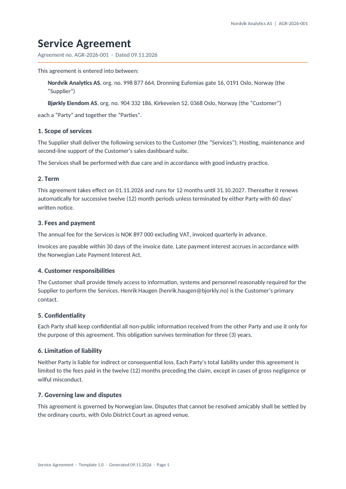
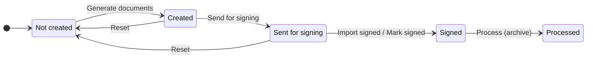
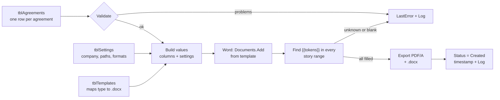

# Agreement Generator (Excel VBA + Word)

Mass-produce business agreements from rows in Excel and track each one from **Not created** to **Processed**, without leaving Excel.

This is a rebuild of a tool I made at work for banking agreements. This version uses standard business agreements and fictional data, and it fixes the weak points of the original mechanism (see [What I changed from v1](#what-i-changed-from-v1)).



## What it does

1. **One row = one agreement.** Counterparty, contact, dates, fees and scope sit in an Excel table.
2. **Generate documents.** For each row the macro creates a new Word document from the right template, fills every `{{Placeholder}}` and exports a PDF (and optionally the filled .docx).
3. **Track status in Excel.** Buttons move rows through a fixed flow, stamp the time of each step and write an audit log:



| Button | What happens |
|---|---|
| **Validate** | Checks IDs (blank/duplicate), agreement type and template file, e-mail format, start date and Norwegian org numbers (MOD11). Problems go to `LastError`. |
| **Generate documents** | Not created → Created. PDF to `output\Generated`, hyperlink in `DocumentPath`. |
| **Send for signing** | Created → Sent for signing. Optionally saves an Outlook draft per agreement with the PDF attached. |
| **Import signed** | Scans `output\Signed` for files containing the AgreementID and moves those rows to Signed. |
| **Mark signed** | Manual alternative for selected rows (e.g. signed on paper). |
| **Process** | Signed → Processed. Moves the signed file to `output\Archive\<year>`. |
| **Reset** | Puts selected rows back to Not created after a data fix. Asks for a reason and renames the old PDF to `*_VOID_<timestamp>`. |
| **Demo: simulate signing** | Copies sent PDFs into `output\Signed` as if they came back from an e-signing service. |

Each button works on the **selected rows**, or on **every eligible row** when nothing in the table is selected.

## How it works



- **Placeholders come from the template, not the code.** The macro searches each document for the pattern `{{Name}}` (Word wildcard `\{\{[A-Za-z0-9_]@\}\}`) and looks the name up in the row's column headers, the Settings keys and two computed fields (`DocumentDate`, `TemplateVersion`). A new field is a new column plus a new token in the template; no code change.
- **No half-filled PDFs.** If a template uses a field that doesn't exist, or whose value is blank for that row, the PDF is not exported and the row gets a clear error.
- **Every part of the document** is processed: body, tables, headers, footers, text boxes.
- **One Word instance per batch**, always closed, even after an error. A failing row is logged and the batch continues.

## Repository structure

```
agreement-generator-vba/
├── AgreementGenerator.xlsx     # tracker with 30 mock agreements (import the VBA, save as .xlsm)
├── src/vba/                    # VBA source, version-controlled as text
│   ├── modMain.bas             # button entry points, setup, demo
│   ├── modDocuments.bas        # Word filling, PDF export, Outlook drafts
│   ├── modStatus.bas           # state machine, row targeting, validation
│   └── modUtils.bas            # settings, table access by header, log, files
├── templates/                  # Service Agreement, Mutual NDA, Consultancy Agreement
├── scripts/                    # Python that builds the templates, mock data and README images
├── docs/                       # improvement notes, sample PDF, images
└── output/                     # created by Setup (git-ignored)
```

## Setup (Windows, Excel + Word)

1. Clone or download the repo and open `AgreementGenerator.xlsx`.
2. **File → Save As → Excel Macro-Enabled Workbook (.xlsm)** in the same folder.
3. `Alt+F11` → **File → Import File…** → import the four files in `src/vba`.
4. `Alt+F8` → run **Setup**. It creates `output\Generated`, `output\Signed`, `output\Archive` and adds the buttons.
5. Try the flow: **Validate** → **Generate documents** → **Send for signing** → **Demo: simulate signing** → **Import signed** → **Process**. Watch the Dashboard and Log sheets.

No library references are needed (Word, Outlook and FileSystemObject are late-bound). If the workbook sits in a OneDrive folder, set `TemplateFolder` and `OutputFolder` on the Settings sheet to local paths, because `ThisWorkbook.Path` returns a URL there.

Two rows are broken on purpose (a bad org number and an incomplete e-mail address) so Validate has something to catch.

## Workbook

| Sheet | Purpose |
|---|---|
| How to use | Setup steps and rules |
| Dashboard | Live counts and contract value by status and agreement type |
| Agreements | `tblAgreements`: inputs (teal header) and macro-written audit columns (dark header) |
| Settings | `tblSettings`: company details, folders, date/number formats, switches. Every key is also a placeholder |
| Templates | `tblTemplates`: AgreementType → template file, file prefix, template version |
| Log | `tblLog`: timestamp, ID, action, from/to status, Windows user, message |

## What I changed from v1

The first version did the job, but the mechanism had weak spots that show up at scale. Full write-up with code examples: [docs/IMPROVEMENTS.md](docs/IMPROVEMENTS.md).

| v1 (original) | v2 (this repo) |
|---|---|
| Hard-coded list of find/replace pairs in the code | Placeholders discovered in the template, matched to column headers |
| Opened the template file itself, then *Save As* | `Documents.Add(Template:=…)`, so the template can't be overwritten |
| Replaced text in the main body only | Body, headers, footers and text boxes (all story ranges) |
| `Find.Replacement.Text`, limited to 255 characters | Sets `Range.Text`, no length limit, keeps formatting |
| Leftover `{{tokens}}` could end up in a sent PDF | Unknown or blank placeholders block the export |
| Columns referenced by letter | Columns looked up by header name in an Excel table |
| Status was a free-text column | One-step-forward state machine, timestamps, audit log |
| One error stopped the batch (and could leave Word running) | Per-row error handling, Word always closed |
| Paths in the code | Settings sheet, relative to the workbook |
| Code lived only inside the .xlsm | `.bas` files in Git, diffable |

## Ideas for v3

- **E-signing API** (e.g. Signicat or Posten for BankID, DocuSign, Adobe Sign): send via REST from VBA and update status from the provider's status endpoint instead of the folder drop.
- **Brreg lookup**: fill counterparty name and address from the org number via the Brønnøysund Register API, and flag deleted or bankrupt companies before an agreement is generated.
- **Conditional clauses**: include optional sections (e.g. a GDPR data-processing clause) based on a column, using bookmarks or Building Blocks.
- **Lock the Status column** with sheet protection (`UserInterfaceOnly:=True`) so status only changes through the macros.
- **Power Platform version**: SharePoint list + Power Automate *Populate a Microsoft Word template* + an e-signing connector, for multi-user and no desktop dependency.

## Notes

All companies, people and organisation numbers are fictional and randomly generated; any match with a real entity is coincidental. Norwegian org numbers are generated to pass the MOD11 check. The agreement texts are simplified examples, not legal advice.

Rebuild the templates, mock data or README images with Python: `pip install -r requirements.txt`, then `python scripts/build_templates.py`, `python scripts/build_workbook.py`, `python scripts/render_samples.py` (needs LibreOffice and poppler).
